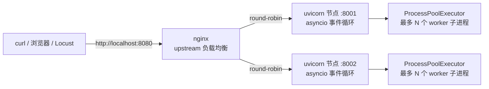

# Concurrency and Parallelism 实验：FastAPI + asyncio + ProcessPoolExecutor + nginx 负载均衡

这是一个动手实验项目，目的是用一个最小可运行的例子，亲手体会 Python 里**并发（concurrency）**和**并行（parallelism）**的区别，并借助 nginx 负载均衡、Locust 压测、psutil 进程监控，把"理论"落到可观察、可复现的实验数据上。

> 这份 README 按照实际踩坑的顺序写，既是操作手册，也是复习笔记——过一阵子忘了，照着从头走一遍就能重新建立手感。

---

## 1. 核心概念与代码设计

- **并发（asyncio）**：`handle_request` 里的 `await asyncio.sleep(0.5)` 模拟 I/O 密集型操作（比如等数据库/外部 API）。单个事件循环可以在等待 I/O 的同时处理其他请求，这是"并发"——不需要多核，靠的是不阻塞地切换任务。
- **并行（ProcessPoolExecutor）**：`heavy_cpu_calculation` 是纯 CPU 密集型任务（累加 `i**0.5 * 3.1415926`）。asyncio 单线程事件循环没法并行跑 CPU 任务（会卡住整个循环），所以通过 `run_in_executor(process_pool, ...)` 把计算丢给独立的子进程去跑，真正利用多核——这是"并行"。

```python
process_pool = ProcessPoolExecutor(max_workers=6)  # 子进程数 = 并行度上限

@app.get("/api/task")
async def handle_request():
    await asyncio.sleep(0.5)                                    # 并发：I/O 等待
    cpu_result = await asyncio.get_event_loop().run_in_executor( # 并行：CPU 计算丢给子进程
        process_pool, heavy_cpu_calculation, 50000000
    )
```

- **nginx 负载均衡**：在两个 FastAPI 节点（8001/8002）前面放一层 nginx，做请求分发（横向扩展），体会"多进程/多节点并行"和"单进程内部并行"是两个不同层次的问题。

### 架构图



---

## 2. 环境准备

- Python 虚拟环境（本仓库假设用的是独立 venv，不随代码提交）
- 依赖：`fastapi`、`uvicorn`、`psutil`、`locust`
- 公司网络访问 PyPI 慢/被拦截时，用国内镜像：
  ```powershell
  pip install locust -i https://pypi.tuna.tsinghua.edu.cn/simple
  ```

---

## 3. 安装与配置 nginx（Windows）

### 3.1 安装
nginx 在 Windows 上是独立的二进制程序，**和 Python 虚拟环境无关**——虚拟环境只用来跑 FastAPI/uvicorn，nginx 单独管理。

```powershell
Invoke-WebRequest -Uri "http://nginx.org/download/nginx-1.26.2.zip" -OutFile "$env:TEMP\nginx.zip"
Expand-Archive -Path "$env:TEMP\nginx.zip" -DestinationPath "C:\nginx"
```
得到 `C:\nginx\nginx-1.26.2\nginx.exe`。

### 3.2 用项目自带的配置文件启动（而不是覆盖 nginx 自带的 conf）
`nginx.exe` 支持 `-c <配置文件绝对路径>` 指定要加载的配置，`-p <prefix>` 指定日志/相对路径的根目录：

```powershell
cd C:\nginx\nginx-1.26.2
.\nginx.exe -t -c "C:\...\ConcurrencyAndParallism\nginx.conf"   # 先测语法
start nginx -c "C:\...\ConcurrencyAndParallism\nginx.conf"      # 后台启动（一定要用 start，否则前台阻塞且 Ctrl+C 关不掉）
```

### 3.3 启停命令
```powershell
.\nginx.exe -c "配置路径" -s reload   # 改完配置热加载
.\nginx.exe -s stop                   # 快速停止
taskkill /F /IM nginx.exe             # 卡住时强制清理（在确认没有误杀其他 nginx 实例的前提下）
```
**Windows 上 nginx 不支持 Ctrl+C 优雅退出**——它靠命名管道传 `-s stop/quit/reload`，不是 POSIX 信号。前台直接跑 `nginx.exe` 会占住终端，而且 Ctrl+C 可能根本不生效，必须用 `start` 或另开终端发 `-s` 命令。

### 3.4 本项目的 `nginx.conf`
```nginx
events {
    worker_connections 1024;
}

http {
    upstream my_python_cluster {
        server 127.0.0.1:8001;
        server 127.0.0.1:8002;
    }

    server {
        listen 8080;
        server_name localhost;

        location / {
            proxy_pass http://my_python_cluster;
            proxy_connect_timeout 600s;
            proxy_read_timeout 600s;
            proxy_send_timeout 600s;
            proxy_set_header Host $host;
            proxy_set_header X-Real-IP $remote_addr;
        }
    }
}
```
- `events {}` 和 `http {}` 必须存在，`upstream`/`server` 指令必须嵌套在 `http {}` 里，这是 nginx 的硬性语法上下文规则。
- `listen` 用 **8080** 而不是 80：Windows 上监听 1024 以下端口需要管理员权限，且常被系统保留端口段占用（`netsh interface ipv4 show excludedportrange protocol=tcp` 可查），用高位端口能跳过这个麻烦。
- `proxy_*_timeout` 调到 600s，是因为早期测试里单次 CPU 任务能跑到上百秒，默认 60s 超时会提前触发 `504 Gateway Timeout`。

### 3.5 踩过的坑（原样记录，方便复习）
| 现象 | 原因 | 解决 |
|---|---|---|
| `[emerg] no "events" section` | 顶层缺少 `events {}` | 补一个 `events { worker_connections 1024; }` |
| `[emerg] bind() to 0.0.0.0:80 failed (10013)` | Windows 下 80 端口需要管理员权限，或被系统保留段占用 | 改用 8080 这类高位端口，或以管理员身份运行 |
| `[emerg] "listen" directive is not allowed here` | `listen` 指令被误写到了 `server {}` 块外面 | `listen` 只能出现在 `server {}` 内部，一个 server 只保留一条 |
| nginx 日志没有"刷屏" | nginx 默认把日志写到 `logs/access.log` / `logs/error.log` 文件，不输出到控制台 | 看日志文件或 `Get-Content -Wait .\logs\access.log` |

---

## 4. 启动整套环境

开 4 个终端：

```powershell
# 终端1：节点1
python app.py 8001

# 终端2：节点2
python app.py 8002

# 终端3：nginx（用 start，不要前台跑）
cd C:\nginx\nginx-1.26.2
start nginx -c "C:\...\ConcurrencyAndParallism\nginx.conf"

# 终端4：验证
curl http://localhost:8080/api/task
```

多发几次 curl，对照两个节点各自终端打印的 `GET /api/task` 日志，能看到请求交替落到 8001 / 8002——这就是 nginx 默认的 **round-robin（轮询）** 负载均衡策略在生效。

### 一个关于浏览器测试的坑
如果用浏览器而不是 curl 测试，可能会在后端日志里看到一堆 `/api/_app/immutable/...`、`manifest.webmanifest`、`sw.js` 的 404——这些不是你发的请求，是浏览器上**残留的 Service Worker**（之前某个 PWA/SvelteKit 项目注册在同一 origin 下）在后台偷偷刷新自己的资源缓存，被 nginx 一并转发到了 FastAPI 上。排查方法：F12 → Application → Service Workers → Unregister，或者干脆用 curl 测试更干净。

---

## 5. 用 psutil 做进程级观测（`monitor.py`）

**设计原则**：监控脚本要和业务代码（`app.py`）解耦——`app.py` 只管业务逻辑，不应该嵌入 profiling 代码；监控应该是"从外部观察"，这样不管起几个节点，同一个监控脚本都能复用。

### 用法
```powershell
python monitor.py
```
它会：
1. 遍历所有进程，按"进程名是 `python.exe`" + "命令行里包含 `app.py`"筛出两个节点的主进程
2. 对每个主进程调用 `children(recursive=True)`，拿到它懒启动的 `ProcessPoolExecutor` worker 子进程
3. 每秒打印一次每个主进程和其子进程各自的 CPU 占用率

### 踩过的坑：自动发现进程并不总是可靠
Windows 上可能存在"外层 `python.exe` 包一层内层 `python.exe`"的情况（比如 App Execution Alias 占位程序，或者终端启动方式导致父进程的命令行里也带上了完整的命令字符串），单纯靠"进程名+命令行子串"模糊匹配可能会把**父级 shell 或 launcher 进程**也误判成一个节点，造成监控输出嵌套、重复、分不清谁是谁。

**更可靠的替代方案**：不自动发现，直接把节点启动日志里打印的 PID 显式传进去：
```python
# Started server process [18948]  <- 这行日志里的 PID 就是权威来源
python monitor.py 18948 17616
```
用显式 PID 彻底避免了"猜哪个 python.exe 才是真节点"的问题。

### 观察到的现象
- `ProcessPoolExecutor` 是**懒启动**的：节点刚启动时只有主进程，第一次有计算任务提交后才会按需 fork 出 worker 子进程，之后常驻复用，不会在请求处理完后退出
- 每个进程池还会多出一个 `resource_tracker` 辅助进程（`multiprocessing` 模块自带，用于清理共享信号量），容易被误认成 worker
- 只有主进程退出（`Ctrl+C`），`atexit` 钩子才会触发进程池清理，worker 和 resource_tracker 才会一起消失

---

## 6. 压力测试与数据分析

### 6.1 工具选择：为什么用 Locust
Windows 上 `wrk` 没有官方构建（得用 WSL），`hey` 够用但没有实时曲线；`locust` 是纯 Python（`pip install locust` 直接装进现有 venv），自带 Web UI（默认 `http://localhost:8089`），能实时看 RPS / 响应时间曲线、按阶梯调并发用户数——学习阶段最直观。

### 6.2 `locustfile.py`
```python
from locust import HttpUser, task

class ApiUser(HttpUser):
    @task
    def hit_task(self):
        self.client.get("/api/task")
```
**注意**：`python locustfile.py` 直接运行不会报错但也什么都不做——这个文件只是"声明"，没有 `__main__` 入口，必须用 `locust` 命令去加载它：
```powershell
locust -f locustfile.py --host http://localhost:8080
```
然后浏览器打开 `http://localhost:8089`，填并发用户数（Users）和启动速率（Spawn rate），点 Start。

### 6.3 怎么设计对比实验
控制变量，固定压测参数（相同并发用户数），只改一个因素，对比结果：
- **nginx 只配一个 upstream**（单节点）vs **配两个 upstream**（负载均衡），对比总吞吐和长尾延迟
- **调整 CPU 任务量级**：`1000000000`（单次要上百秒）vs `50000000`（单次 1~3 秒），观察 RPS/延迟/nginx 超时表现
- **调整 `ProcessPoolExecutor(max_workers=...)`**：4 vs 6（每节点），观察 RPS 和 CPU 利用率变化

### 6.4 怎么读 Locust 的输出
- **Statistics 页**：看 `Median (ms)` / `95%ile (ms)` / `Current RPS`，这是稳定运行一段时间后的瞬时/中位数指标
- **Charts 页**三张图配合看：
  - `Total Requests per Second`：实时吞吐量曲线
  - `Response Times (ms)`：50/95 分位延迟曲线
  - `Number of Users`：当前并发用户数（阶梯变化，对应你在 Web UI 里调整的值）

### 6.5 实测结果与解读（按实验顺序记录）

| 场景 | 每节点 max_workers | 并发 Users | 单任务计算量 | 观察到的 RPS | Median / 95%ile 延迟 | 解读 |
|---|---|---|---|---|---|---|
| A | 4+4=8 | 8 | 1,000,000,000（~100s/次） | 0~0.4，锯齿状 | ~10万 ms | 单任务耗时远超并发槽位周转速度，RPS 完全由"单任务耗时"主导，呈脉冲式 |
| B | 4+4=8 | 8 | 50,000,000（~5s/次） | 稳定 ~1.6~2 | Median ≈4.6~5.6s，95%ile ≈7.4~7.6s | 吞吐稳定，符合 **Little's Law**：`并发数 ≈ RPS × 平均延迟`，即 `8 ≈ 1.6 × 5s` |
| C | 4+4=8 | 20 | 50,000,000 | 仍然 ~1.6~2，不随 Users 增加而上涨 | 延迟随 Users 增大而拉长 | 证明瓶颈是**总并行容量（8 个 worker 槽位）**，而不是并发用户数；多出来的用户只是排队 |
| D | 6+6=12 | 20 | 50,000,000 | 小幅提升到 ~1.5~2，且更抖动 | 相近或略增 | 理论上 12/8=1.5 倍，但受物理核心数限制（14 核 / 20 逻辑处理器），纯 CPU 计算型任务超线程收益有限，worker 数逼近物理核心数后出现调度抢占，边际收益递减 |

**Little's Law 速算公式**（复习用）：
$$
\text{并发数（Users）} = \text{吞吐量（RPS）} \times \text{平均延迟（秒）}
$$
已知其中两项就能反推第三项，用来快速判断"现在的瓶颈是任务耗时还是并发槽位"。

### 6.6 用 Task Manager / psutil 交叉验证 CPU 饱和
- 8 个 worker 时：Task Manager 的 20 格逻辑核心图里能看到清晰的"8 个核心冲到顶、其余闲着"的分界
- 12 个 worker 时：几乎所有逻辑核心都在跳动，没有明显的忙闲分界——说明已经逼近 14 个物理核心的算力天花板（纯 CPU 浮点计算，超线程基本不增加有效算力）
- 想量化而不是肉眼判断，用 `monitor.py` 里 `psutil.Process(pid).cpu_percent()` 直接读每个 worker 进程分到的 CPU 百分比，对比是否接近 `100% / (worker数 / 物理核心数)`

---

## 7. PowerShell 并发发压小贴士
Windows 自带的 `powershell.exe` 是 5.1，**没有** `ForEach-Object -Parallel`（那是 PowerShell 7+ 才有的）。5.1 下用 `Start-Job` 代替：
```powershell
$jobs = 1..8 | ForEach-Object {
    Start-Job -ScriptBlock { curl http://localhost:8080/api/task }
}
$jobs | Wait-Job | Receive-Job
Get-Job | Remove-Job
```

---

## 8. 文件说明

| 文件 | 作用 |
|---|---|
| `app.py` | FastAPI 节点，演示 asyncio 并发 I/O + ProcessPoolExecutor 并行 CPU 计算 |
| `nginx.conf` | nginx 负载均衡配置，轮询分发到两个节点 |
| `locustfile.py` | Locust 压测脚本定义 |
| `monitor.py` | 基于 psutil 的进程级 CPU 观测工具，与业务代码解耦 |
| `manualTest.ps1` | 手动并发发压的 PowerShell 片段（`Start-Job` 方案） |

---

## 9. 复现实验的最短路径（复习速查）
```powershell
# 1. 启动两个节点
python app.py 8001
python app.py 8002

# 2. 启动 nginx
cd C:\nginx\nginx-1.26.2
start nginx -c "C:\...\ConcurrencyAndParallism\nginx.conf"

# 3. 单独验证负载均衡
curl http://localhost:8080/api/task

# 4. 开始压测
locust -f locustfile.py --host http://localhost:8080
# 浏览器打开 http://localhost:8089

# 5. 另开终端观察进程级 CPU
python monitor.py 18948 17616   # 换成实际打印出的 PID
```
